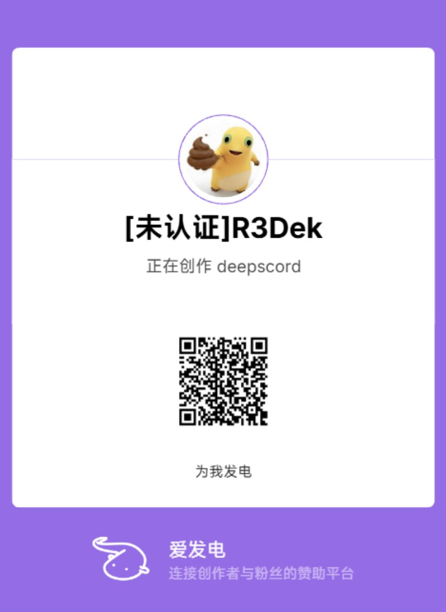
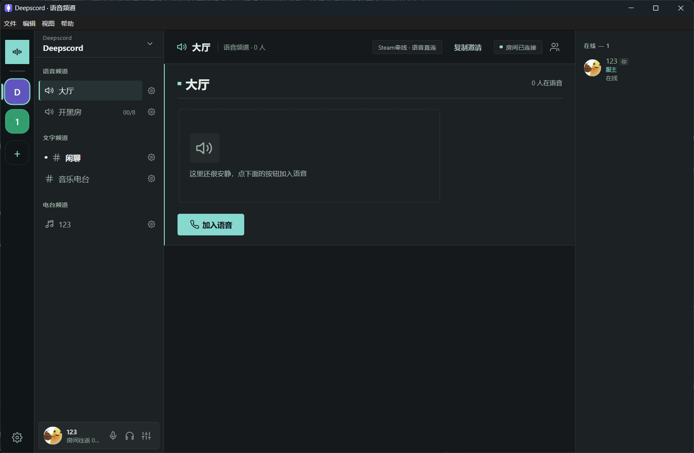
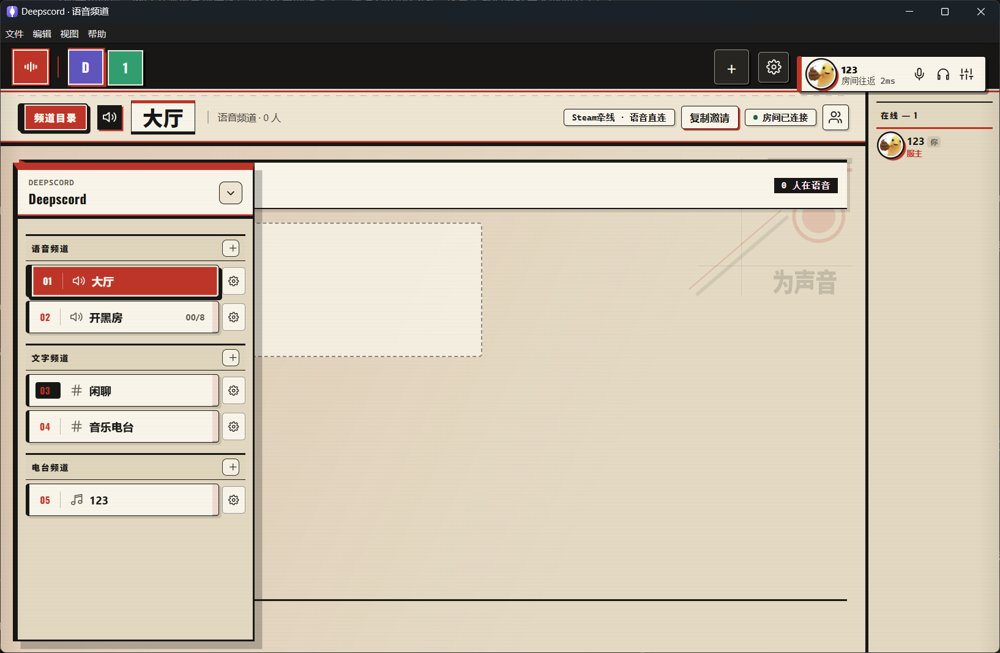
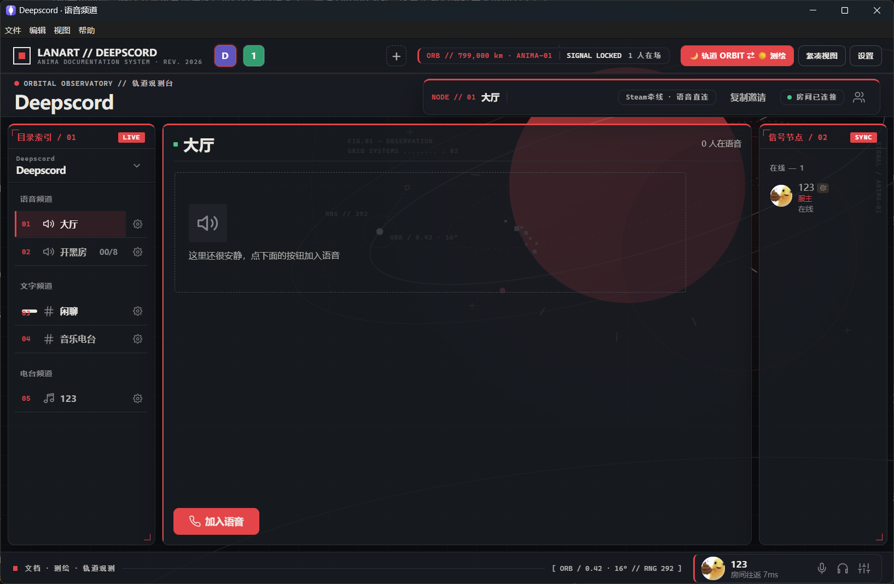

<h1 align="center"></h1>
<p align="center">
  
  
  
  <a href="LICENSE"></a>
</p>
<p align="center"><strong>“我们只是想和朋友打把游戏，不想再给开黑软件交房租。”</strong><br>
Deepscord 给熟人小队一个自己的语音房。登录 Steam 就能开房，喊朋友连麦、看屏幕、指个路。<br>
开临时房无需租服务器，画质和帧率由你来调。</p>
<p align="center"><a href="#下载与加入">📦 下载</a> · <a href="#为什么选择-deepscord">⚡ 核心特性</a> · <a href="#实机界面">🖼️ 实机界面</a> · <a href="#怎么选连接方式">🔌 连接方式</a> · <a href="#从源码运行">🛠️ 源码与文档</a></p>

<h2 align="center">您的发电<strong>不会</strong>获取任何特权或专属物品，该项目坚持免费开源原则，此爱发电仅作为支持我们的方式！</h2>
<p align="center"><a href="docs/assets/afdian-r3dek.jpg"></a></p>

## 为什么选择 Deepscord

- **今晚就能开房。** 发一条 Steam 房间邀请，朋友粘贴后就能加入。局域网里可以直接连房主，长期使用同一组频道的小队也可以部署独立服务端。
- **建房的人可以先下线。** 在 Steam 房间里，仍在线的成员会按照 Steam 大厅的选举结果接替宿主，用已同步的快照恢复频道与聊天。仍在线成员间已有的直连通话会保留。全员离线后，成员可以从本机副本重开原有频道，再发新邀请。谁有管理权由 Ed25519 签名记录决定，接手托管不会获得服主权限。
- **多人看屏幕，可以分摊上行。** 共享窗口或整屏时，可选 480p–2160p、15/24/30/60 帧和 0.3–40 Mbps。有上行余量的桌面观看者可以把压缩画面转发一跳，省去再次编码。也可以用自建 LiveKit SFU 转发。4K60 是采集目标，实际帧率取决于画面、设备和网络。
- **“树后面”说不清，就指给队友看。** 在放大的共享画面里申请指点，对方同意后，点下的位置会在分享者屏幕上显示手指。连续点同一处会强化提示，桌面覆盖层让鼠标操作继续落在游戏窗口。
- **人声、伴奏和电台各有位置。** 在 Windows 上可以把播放器或游戏的音频作为独立伴奏轨发送，麦克风继续用来说话。可以单独调低某位成员的音量，也可以进电台频道一起听直播。文字频道支持消息、回复、图片和表情回应。
- **主题自己换，表情全服用。** 本机 `mods/` 支持整包安装界面主题、AVIF 动静表情和互动道具。主题只改变自己的客户端，服务器表情在各域共用。服主和管理员按授权范围管理频道与成员，还可以分配自定义权限组。[示例资源包](mods/examples/) · [资源包开发指南](public/customization/RESOURCE_PACKS.md)

**房间内容加密可由服主启用。** Windows 客户端可原地迁移已有历史。拿到带密钥邀请的新成员可以读取已迁移的历史，普通网页端无法解密这部分内容。请私下发送带密钥的邀请。[桌面信任与隐私边界](NETWORKING.md#桌面信任与隐私边界)

## 实机界面

<table>
  <tr><td colspan="2" align="center"><a href="docs/assets/ui-default-dark.png"></a><br><strong>原生工程暗色</strong> · 开箱即用的语音大厅</td></tr>
  <tr>
    <td width="50%" align="center"><a href="docs/assets/ui-constructivist-print.png"></a><br><strong>为声音</strong> · 内置构成主义索引</td>
    <td width="50%" align="center"><a href="docs/assets/ui-lanart-orbit.png"></a><br><strong>Lanart</strong> · 白昼测绘与暗夜星轨</td>
  </tr>
</table>

## 下载与加入

[打开最新发布页](https://github.com/An1X3R/deepscord/releases/latest)。下表直达 2026 年 11 月 27 日快照中的三个附件，文件名中的日期对应各自的构建。

| 想做什么 | 下载哪个附件 | 如何使用 |
| --- | --- | --- |
| 加入朋友的房间或自己开房 | [`Deepscord-Performance-20261113.zip`](https://github.com/An1X3R/deepscord/releases/download/snapshot-20261127/Deepscord-Performance-20261113.zip) | 完整解压到可写目录，双击 `Deepscord.exe`。包内已有运行时。 |
| 在 Windows x64 上长期托管 | [`Deepscord-Standalone-Server-Performance-20261113.zip`](https://github.com/An1X3R/deepscord/releases/download/snapshot-20261127/Deepscord-Standalone-Server-Performance-20261113.zip) | 解压到固定目录，运行 `start-server.cmd`，按包内 README 配置对外地址、端口和访问口令。 |
| 使用 Lanart 主题 | [`Deepscord-Lanart-Theme-20261116.zip`](https://github.com/An1X3R/deepscord/releases/download/snapshot-20261127/Deepscord-Lanart-Theme-20261116.zip) | 在客户端设置中打开“资源管理（主题与表情）”，选择“安装 ZIP 包”，然后在本机界面方案中选用。 |

首次打开客户端，在工作区选择**创建服务器**或**加入服务器**。收到邀请的成员选择对应的连接方式并粘贴邀请；连接自建服务器时填写服主给出的 HTTPS 地址和口令。服务器中可以切换域，每个域有自己的频道。进入语音后，还可以切到文字频道发消息。

## 怎么选连接方式

| 方式 | 适用场景 | 连接条件 |
| --- | --- | --- |
| 独立直连 | 局域网，或成员之间网络可达 | 一位成员用 Windows 客户端开房。其他人需要能访问房主的房间 TCP 端口，成员间还需要可用的 UDP 通路。 |
| Steam 牵线 | 两位或多位 Steam 好友临时开房 | 各自登录 Steam、运行同版客户端，通过邀请加入。Steam 负责房间发现与信令，语音走 WebRTC 直连。测试版使用 Valve 示例 AppID `480`，Steam 状态可能显示为 **Spacewar**。 |
| 自建服务器 | 固定社群、长期保存频道，或需要中继 | 独立服务端维护房间和历史。管理员可配置 TURN 中继语音，也可单独启用 LiveKit SFU 转发屏幕。 |

Steam 宿主切换时，房间信令会重连，恢复进度以其他成员已收到的完整快照为准。如果 Steam 邀请能进房、语音却连不上，请分别检查房间连接和成员间的媒体通路。部署参数、证书指纹、TURN 和屏幕转发配置见[网络说明](NETWORKING.md)。Windows 服务端的启动、升级与数据迁移见[独立服务端指南](standalone/README.md)。

## 从源码运行

需要 **Node.js 22.13 或更高版本**。项目在 Node.js 24 上运行持续集成。进入仓库根目录，安装锁定依赖并启动房间服务。

```sh
npm ci --ignore-scripts
npm start
```

在本机浏览器打开 `http://localhost:3000`。默认数据目录是 `data/`，可用 `ECHO_DATA_DIR` 指定其他位置。异地成员通过浏览器使用麦克风时，应使用受信任的 HTTPS 地址。

开发检查与持续集成使用相同的桌面依赖。

```sh
npm --prefix desktop ci --omit=dev --ignore-scripts
npm run test:ci
npm run typecheck
```

要构建 Windows 客户端，还需准备原生辅助程序和匹配版本的 Electron 运行时。构建参数、产物清单和成品验证步骤见 [Windows 客户端打包](NETWORKING.md#windows-客户端打包)。

## 源码与文档

| 位置 | 用途 |
| --- | --- |
| [server.js](server.js)、[lib/](lib/) | HTTP、WebSocket、房间状态、权限、持久化与媒体策略 |
| [public/](public/) | 网页与桌面共用的频道界面、聊天和 WebRTC 逻辑 |
| [desktop/](desktop/) | Electron 主进程、Steam 接入、Windows 采集与覆盖层 |
| [desktop-lite/](desktop-lite/) | 已暂停开发的 WebView2 轻量原型，保留实现与试验记录 |
| [standalone/](standalone/)、[deploy/](deploy/) | 独立服务端发行模板、反向代理、TURN 与 SFU 配置 |
| [test/](test/)、[tools/](tools/) | 回归测试、资源同步、原生组件与发行包构建 |
| [设计说明](DESIGN_BRIEF.md)、[网络说明](NETWORKING.md) | 产品交互、模块边界、网络协议与部署 |
| [性能实测](docs/benchmarks/)、[历史交接与 QA](docs/archive/) | 各报告记录的版本、测试条件与结果 |

## 开源许可

Deepscord 自有代码采用 [GNU GPL 第 3 版（GPL-3.0-only）](LICENSE)。第三方组件及素材各自适用原有许可。

## 特别感谢
跨国网络测试：[AuCl4](https://github.com/AuCl4H)
Lanart主题设计者：[Mon-Landis](https://github.com/Mon-Landis)
联合开发者 早期版本正式由他独立编写而成：[Flx707](https://github.com/Flx707)
